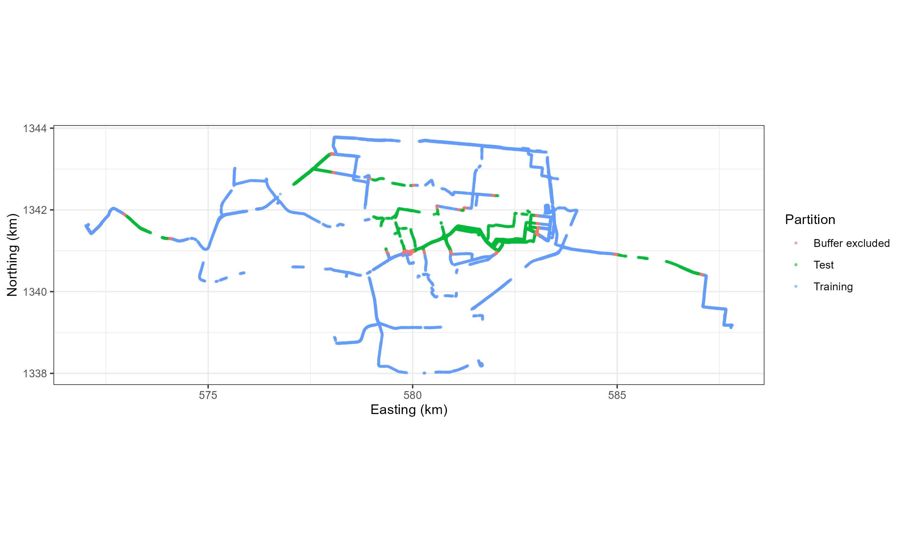
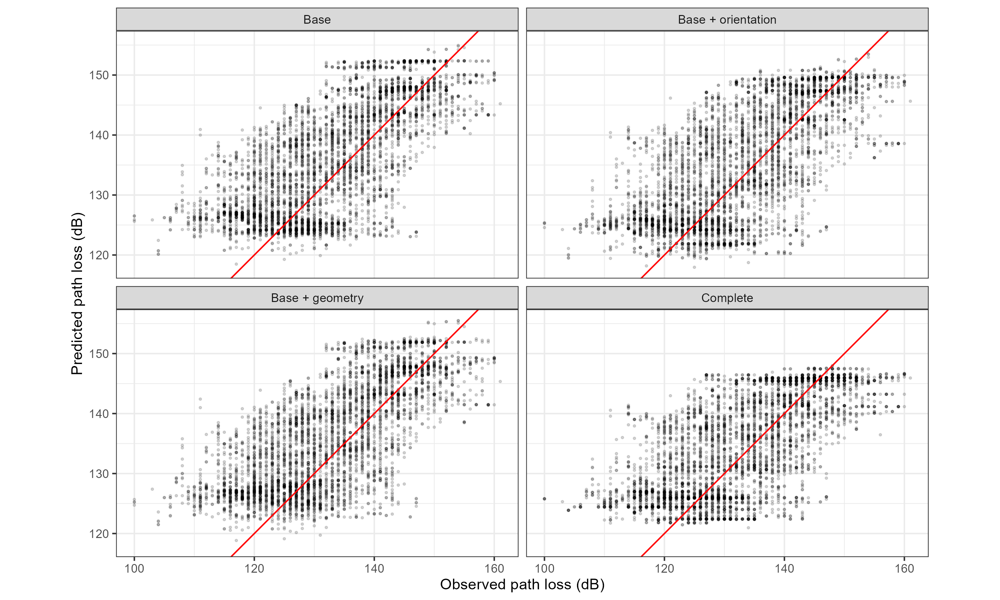
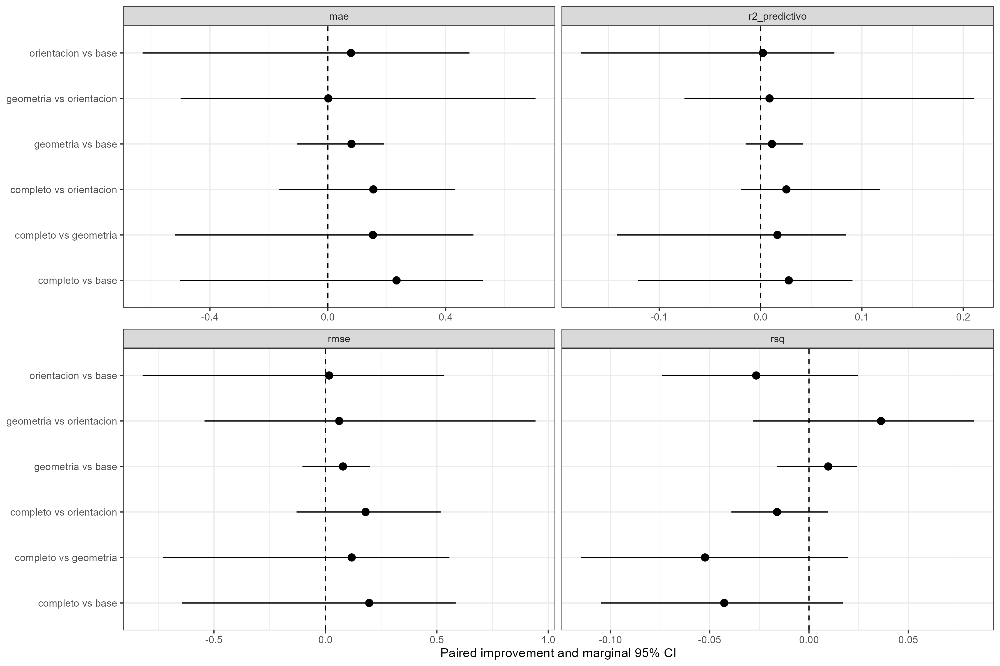

# XGBoost radio propagation: spatial validation and feature ablation

An R / tidymodels study of whether antenna orientation and engineered geometry improve drive-test path-loss prediction. Four XGBoost models share the same spatial resamples and tuning budget. Evaluation includes RMSE, MAE, two R² definitions, paired spatial-bootstrap confidence intervals, residual diagnostics, error by distance/frequency, and native TreeSHAP.

**Main result:** the complete model reduces test RMSE from 8.634 to 8.438 dB and MAE from 6.955 to 6.722 dB. However, every supplied paired 95% interval includes zero. These data do not establish an out-of-sample improvement from adding orientation, nor do they establish equivalence or absence of an effect. Orientation combines azimuth and two tilts; this comparison does not isolate tilt alone.

## Models

| ID | Predictors |
|---|---|
| `base` | log10 distance in km, categorical band, absolute transmitter and receiver heights |
| `orientacion` | Base + mechanical tilt + electrical tilt + sine/cosine of absolute azimuth |
| `geometria` | Base + elevation angle + height-difference / distance ratio |
| `completo` | Base + orientation + geometry |

Geometry features are deterministic transformations of base measurements. They test representation utility, not additional independent measurements. Mechanical and electrical tilt are kept separate.

## Data and spatial validation

The unchanged source workbook is included under `datos_entrada/`. The target is `Perdida = 43 - Level`. Retained distances satisfy 15 ≤ distance < 3000 m and Level > −150 dBm. Missing target/distance rows are excluded. The original 17,872 observations yield 12,768 retained observations.

| Partition | Observations | Spatial blocks |
|---|---:|---:|
| Training after buffer | 7,149 | 43 |
| Test | 5,018 | 11 |
| Excluded by train/test buffer | 601 | — |

Receiver coordinates are projected to a local UTM CRS and assigned to 1 km grid blocks. A random 20% of blocks (rounded up) is reserved for test, yielding **39.30% of retained rows**, not a row-wise 80/20 split. Training points within 100 m of test points are removed. Minimum observed train/test separation is 100.043 m.

Training uses **10 grouped folds × 5 repeats = 50 resamples**, with an additional 100 m exclusion buffer within each split. All four models use identical splits and a common 40-candidate space-filling grid: 2,000 candidate/resample evaluations per model, 8,000 overall (engine submodel reuse can reduce actual fit count). Each model independently selects minimum mean CV RMSE. KNN imputation (5 neighbours), dummy encoding, zero-variance removal and normalization are estimated within each resample. Common donor features exclude orientation.

**Spatial limitation:** 33 cell identifiers occur in both training and test. The design assesses held-out receiver blocks; it does not demonstrate transfer to unseen base stations, cells or routes. One-kilometre blocks and a 100 m buffer do not by themselves prove independence. The test has already informed exploratory analyses and is not a fresh external confirmation set.

Seeds: split 123; folds 42; tuning grid 2026; model fits 2027; bootstrap 2028. XGBoost uses one thread, sequential execution and no early stopping.

## Held-out performance

| Model | RMSE (dB) | MAE (dB) | Squared correlation | Predictive R² |
|---|---:|---:|---:|---:|
| Base | 8.6343 | 6.9548 | 0.4893 | 0.3822 |
| Base + orientation | 8.6177 | 6.8762 | 0.4627 | 0.3846 |
| Base + geometry | 8.5555 | 6.8746 | 0.4990 | 0.3935 |
| Complete | 8.4375 | 6.7219 | 0.4466 | 0.4101 |

`rsq` is squared Pearson correlation, whereas `r2_predictivo = 1 − SSE/SST`. They are not interchangeable: squared correlation does not directly measure prediction calibration.

### Paired improvements relative to Base

Positive error improvement means Base error minus candidate error. These are marginal percentile 95% CIs from 2,000 paired resamples of the 11 complete test blocks, with models held fixed.

| Candidate | RMSE reduction (dB), 95% CI | MAE reduction (dB), 95% CI |
|---|---:|---:|
| Orientation | 0.0166 [−0.8201, 0.5326] | 0.0786 [−0.6281, 0.4804] |
| Geometry | 0.0788 [−0.1032, 0.2011] | 0.0802 [−0.1037, 0.1905] |
| Complete | 0.1968 [−0.6449, 0.5848] | 0.2329 [−0.5014, 0.5270] |

All six pairwise comparisons, four metrics and model-level intervals are available in `reports/reference/tablas/10_IC95_metricas_por_modelo.csv` and `11_IC95_diferencias_pareadas.csv`. See [methodology](docs/METHODOLOGY.md) for formulas and assumptions. Eleven test blocks limit precision; the bootstrap does not include training/tuning uncertainty or adjust for multiple comparisons. Subgroup patterns are descriptive.

## Selected hyperparameters

| Model | Trees | min_n | Depth | Learning rate | Loss reduction | Sample proportion |
|---|---:|---:|---:|---:|---:|---:|
| Base | 1300 | 17 | 2 | 0.01701254 | 0.00017013 | 0.66794872 |
| Orientation | 1300 | 17 | 2 | 0.01701254 | 0.00017013 | 0.66794872 |
| Geometry | 1300 | 17 | 2 | 0.01701254 | 0.00017013 | 0.66794872 |
| Complete | 500 | 21 | 2 | 0.00837678 | 0.00070170 | 0.83846154 |

The complete model selects the lower tree-count boundary; a broader search is a future experiment requiring appropriate validation. Independently tuned models compare feature pipelines under equal search budgets, not the effect of features at identical hyperparameters.

## Figures







Residuals, error distributions, distance/frequency diagnostics, tuning results and four SHAP plots are included in the reference folders. Filenames are in English; original data feature names and some model IDs are retained in existing plots.

## Run from a fresh R session

Open `Ablacion_Orientacion_Geometria.Rproj` in RStudio or the repository folder in Positron. Keep the project root as the working directory.

```r
source("install_dependencies.R")
source("01_preparar_datos.R")
# Inspect the spatial map and audit tables before the expensive tuning.
source("02_tuning.R")
source("03_evaluacion_IC_graficos.R")
source("04_SHAP_opcional.R") # optional, after evaluation
```

Alternatively, `source("EJECUTAR_TODO.R")` runs preparation, tuning and evaluation; it does not pause for design review or run SHAP automatically. Configure paths/seeds in `00_config.R`. New outputs go to `resultados/Ablacion_Orientacion_Geometria_github_v1/`, separate from the immutable supplied reference exports. Use a new execution ID after changing scripts, input, packages or configuration. Tuning can take hours. Checkpoints are saved after each whole model, not each fold; an interrupted model must be restarted.

`reports/reference/sessionInfo.txt` records the original package environment (not an executable lockfile). Fitted/tuning RDS objects were not supplied; they must be regenerated to refit models or recompute SHAP. Existing CSVs and PNGs can be inspected without training.

## Repository contents

- Root R scripts: configuration, data preparation, tuning, evaluation/CIs, optional SHAP and runner.
- `datos_entrada/`: original workbook and field/provenance notes.
- `reports/reference/`: supplied numerical results, figures, SHAP summaries and session information.
- `docs/`: methodology, packaging changes, verification summary, filename mapping and archival scripts from the original results ZIP.
- `resultados/`: generated locally and ignored by Git.

## Interpretation and scope

SHAP values explain the fitted model, not a causal contribution or an independent performance gain. Absolute azimuth is not the transmitter-to-receiver angular misalignment. The supplied distance is assumed horizontal for engineered elevation angle; horizontal versus 3D provenance has not been verified. The 43 dBm reference and measured Level definition need a documented radio link budget. No conventional propagation-model comparison is included.

Data were supplied through the research collaboration with Cedrick. Repository preparation: Yader Alexander Ramírez Bonilla. No article or manuscript is distributed. No open redistribution license for code or data is asserted without an owner-selected license. See [input notes](datos_entrada/README.md).

Validation during repository preparation: exported point metrics independently recalculated from 20,072 prediction rows; paired point improvements and all 50 fold audits checked. Full R execution, retraining and regeneration of bootstrap/SHAP were not performed in the preparation environment. See [verification](docs/verification.json) and [changes](docs/REPOSITORY_CHANGES.md).
